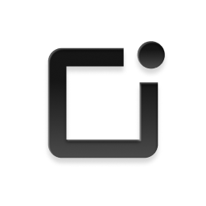

# Boya OS



Connect Claude to your own Boya OS recordings. This repository contains a read-only remote MCP server integration and a skill that teaches Claude how to use its nine tools well.

- Remote MCP server: `https://mcp.boyaos.com/mcp`
- Authentication: OAuth 2.0 with dynamic client registration
- Access: read-only, limited to the signed-in Boya OS account
- Plugin name: `boya-os`

## Eligibility

You must be at least 18 years old to use this connector.

## What you can do

- List recordings by date, folder, or duration.
- Search titles, transcripts, and AI summaries with literal keyword matching.
- Read a full transcript with optional timestamps and speaker labels.
- Read AI summaries and mind maps.
- Review action items, including which ones are real to-dos.
- List bound recording devices and folders.
- Request a short-lived audio playback link when you explicitly ask for a recording's audio.

## Tools

| Tool | What it does | Example prompt |
|---|---|---|
| `list_recordings` | List recordings with optional date, folder, and duration filters. Paginated. | List my recordings from this week. |
| `search_recordings` | Literal keyword substring search over titles, transcripts, and AI summaries. Not semantic search. | Find recordings discussing product meetings. |
| `list_folders` | List recording folders with the number of recordings directly in each. | What recordings are in my work folders? |
| `list_devices` | List recording devices bound to the account. Cannot filter recordings by device. | Which recording devices are bound to my account? |
| `get_recording` | Get recording metadata and content flags. Optionally returns an audio playback link. | Show me my most recent product review recording. |
| `get_transcript` | Get the full transcript with optional timestamps and speaker labels. Paginated. | Show me the full transcript of my most recent product review meeting. |
| `get_summary` | Get the AI-generated summary or meeting notes. Returns an empty state if none exists. | Show me the summary of my most recent product review meeting. |
| `get_map` | Get the AI-generated mind map. Returns an empty state if none exists. | Show me the mind map of my most recent product review meeting. |
| `get_action_items` | Get action items across recordings or for one recording. | What are my action items? |

Every tool is annotated `readOnlyHint: true`, `destructiveHint: false`, and `openWorldHint: false`.

## Install

### Claude apps and Claude Code

1. Open the Claude connectors or plugin directory.
2. Find **Boya OS** and select it.
3. Approve the OAuth consent screen for your Boya OS account.

Claude prompts you to authorize the MCP server on first use.

### Claude Code as a custom connector

```
claude mcp add --transport http boya-os https://mcp.boyaos.com/mcp
```

### Load the plugin from a local clone

```
git clone https://github.com/zengxingping/boya-os
claude --plugin-dir ./boya-os
```

## Authentication

Boya OS uses OAuth 2.0. The MCP server publishes protected resource metadata, and the authorization server supports dynamic client registration and PKCE.

| Item | Value |
|---|---|
| Protected resource metadata | `https://mcp.boyaos.com/.well-known/oauth-protected-resource` |
| Authorization server | `https://mcp.boyaos.com` |
| Authorization endpoint | `https://mcp.boyaos.com/oauth2/authorize` |
| Token endpoint | `https://mcp.boyaos.com/oauth2/token` |
| Registration endpoint | `https://mcp.boyaos.com/oauth2/register` |
| JWKS | `https://mcp.boyaos.com/oauth2/jwks` |
| Revocation endpoint | `https://mcp.boyaos.com/oauth2/revoke` |
| Scope | `mcp.boyaos.com:read` |
| PKCE | `S256` |

The access token is bound to your Boya OS user and the read scope. Revoking the grant in your Boya OS account invalidates the token.

## Data access and handling

The plugin contains no executables and runs no local code. It declares one remote MCP server plus Markdown skill instructions.

When you use a tool, Claude sends your tool arguments and the OAuth access token to `https://mcp.boyaos.com/mcp`. The server reads matching data from your Boya OS account and returns it.

The connector reads:

- Recording metadata, folders, and bound device records.
- Transcripts, AI summaries, mind maps, and action items that already exist.
- An audio playback link only when you explicitly request audio.

The connector does not:

- Read Claude memory, chat history, summaries, or files you upload to Claude.
- Receive Claude conversation text beyond the tool arguments needed for your request.
- Use data for model training.
- Sell data or send it to third-party services. Hosting infrastructure processes data only on Boya OS's behalf.
- Record, edit, delete, or generate transcripts, summaries, mind maps, or to-dos.

The server keeps an operational audit record for each tool call. Each record contains the tool name, result code, timing, region, OAuth client ID, a SHA-256 digest of the arguments, and a truncated plaintext copy of the arguments for support and abuse investigation. It does not store returned transcripts, summaries, mind maps, or audio. Audit records are retained for 7 days and then deleted.

Audio is off by default. When you explicitly request audio, the server returns a pre-signed playback link valid for 10 minutes. Request the recording again after it expires.

## Limits and behavior

- **Read-only.** The connector never writes, deletes, or generates content.
- **Literal search.** `search_recordings` matches substrings; it is not semantic or fuzzy search.
- **No device filter.** `list_devices` lists devices, but `list_recordings` cannot filter by device.
- **Empty states are normal.** A recording without a transcript or summary returns an empty result, not an error and not generated content.
- **Cross-account access is blocked.** Missing and unauthorized recordings return the same `RESOURCE_NOT_FOUND` response.
- **Action items have two sources.** `completable=true` means a real to-do that can be completed in the app. `completable=false` means an item mentioned in a summary that is not a to-do.

## Example prompts

- List my 3 most recent recordings.
- Find recordings discussing product meetings.
- Show me the full transcript of my most recent product review meeting.
- Show me the summary and mind map of my most recent product review meeting.
- What are my action items?
- Which recording devices are bound to my account?

## Troubleshooting

| Symptom | Fix |
|---|---|
| 401 or authorization error | Reconnect the connector and complete the OAuth consent screen again. |
| Empty transcript or summary | The recording may still be processing or may not have that content yet. Open the Boya OS app to generate it. |
| Audio link expired | Call `get_recording` with `include_audio_url=true` again. |
| No search results | Search is literal substring matching. Try a shorter keyword that appears in the title, transcript, or summary. |

## Repository layout

```
.claude-plugin/plugin.json   Plugin manifest
.mcp.json                    Remote MCP server declaration
skills/boya-os-recordings/   Skill instructions and tool reference
assets/icon.png              Listing icon
LICENSE                      Proprietary license
README.md                    This documentation
```

## Support

- Support: https://www.boyamic.com/support
- Support email: support@boyamic.com
- Website: https://www.boyamic.com/
- Privacy policy: https://ai.boyaos.com/policies/BOYANotraDataSecurity&PrivacyPolicyvEN.html
- Terms of service: https://ai.boyaos.com/policies/BOYANotraTermofServiceEN.html

## License

Proprietary. See [LICENSE](LICENSE).
